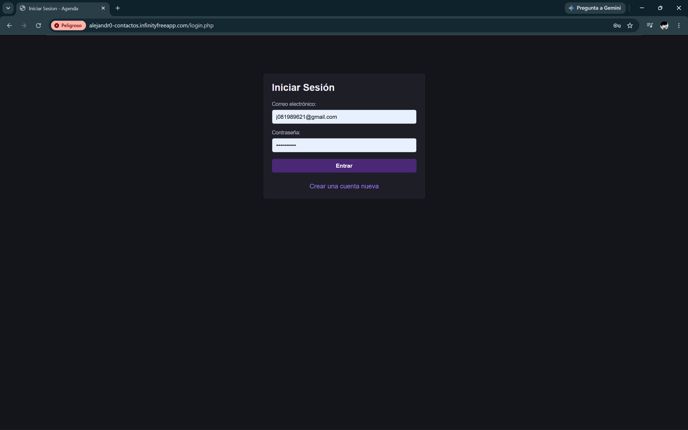
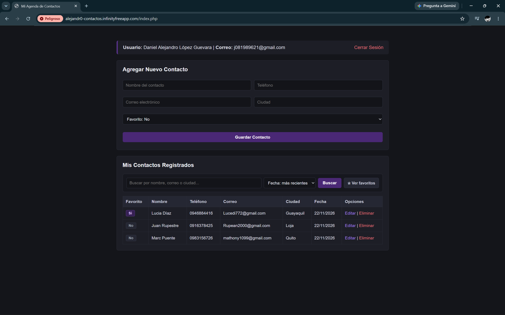
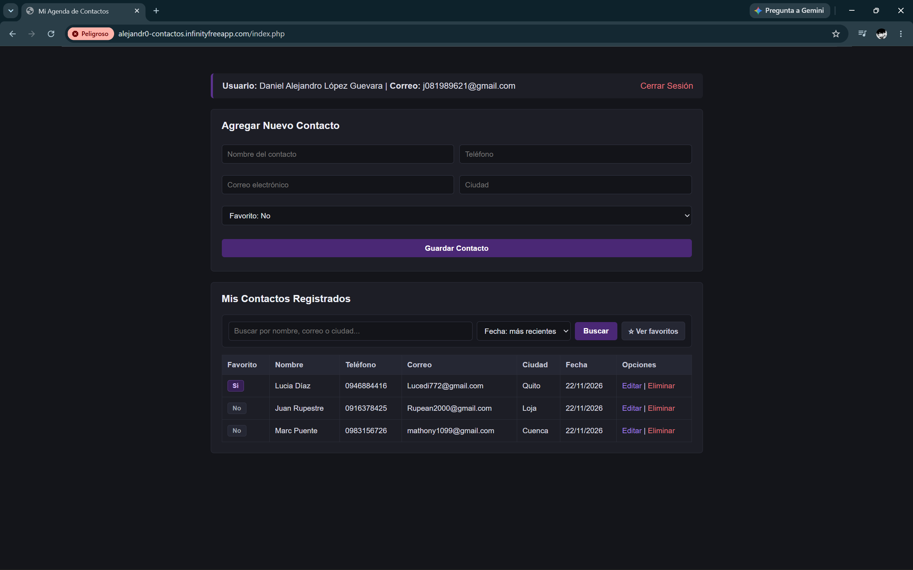

# Agenda Personal de Contactos con Autenticación en PHP y MySQL

## 1. Descripción del proyecto
Aplicación web desarrollada en PHP y MySQL en la que se implementa mecanismos de autenticación de usuarios, un manejo seguro de sesiones y la gestión de una agenda personal de contactos. El sistema garantiza el aislamiento de la información mediante controles en el servidor para que cada usuario visualice y administre exclusivamente sus propios contactos, impidiendo el acceso cruzado incluso ante modificaciones manuales de la URL.

## 2. Tecnologías utilizadas
* **Lenguaje de servidor:** PHP 8.x (acceso a datos mediante extensión PDO y sentencias preparadas).
* **Gestor de base de datos:** MySQL / MariaDB.
* **Frontend:** HTML5, CSS3 y JavaScript.
* **Entorno de desarrollo y hosting:** Visual Studio Code, XAMPP (Apache + MySQL) e InfinityFree.

## 3. Despliegue en línea y video explicativo
* **Aplicación web en producción:** http://alejandr0-contactos.infinityfreeapp.com/login.php
* **Video explicativo de la actividad:** https://youtu.be/7P9F1EsAC14

> **Nota sobre la advertencia del navegador:** Al abrir el enlace desplegado en InfinityFree, navegadores como Google Chrome pueden mostrar una pantalla preventiva (*"Sitio peligroso"* o *"La conexión no es privada"*) por tratarse de un subdominio gratuito sin certificado SSL (`HTTP`). Para acceder al sistema, haga clic en **Detalles** y seleccione **visitar este sitio no seguro**.

## 4. Mejoras implementadas en esta versión
* **Búsqueda dinámica:** Filtrado de contactos por nombre, correo electrónico o ciudad mediante consultas preparadas (`LIKE`).
* **Ordenamiento personalizado:** Organización de registros por fecha de creación (más recientes o más antiguos), nombre (A-Z / Z-A) y ciudad (A-Z / Z-A).
* **Gestión de favoritos:** Marcado rápido (`Sí` / `No`) desde el formulario o directamente en la tabla, junto con un filtro dedicado para visualizar únicamente los contactos favoritos.
* **Conexión adaptable:** Detección automática del entorno en `conexion.php` para alternar entre servidor local (`localhost`) y producción (`InfinityFree`).

## 5. Requisitos para su ejecución local
* Servidor local XAMPP (o equivalente) con los servicios Apache y MySQL activos.
* PHP 7.4 o superior (recomendado PHP 8.x).
* Navegador web (Chrome, Firefox, Edge).

## 6. Pasos para instalar la aplicación
1. **Clonar o descargar el proyecto:** Coloque la carpeta `agenda_contactos` dentro del directorio raíz de su servidor web local (en XAMPP: `C:\xampp\htdocs\agenda_contactos`).
2. **Iniciar servicios:** Abra el panel de control de XAMPP e inicie los módulos Apache y MySQL.
3. **Importar la base de datos:**
   * Ingrese a `http://localhost/phpmyadmin` desde su navegador.
   * Cree una base de datos llamada `agenda_contactos`, diríjase a la pestaña **Importar** y ejecute el archivo `database.sql` incluido en la raíz del repositorio.
4. **Configurar credenciales (opcional):** En entorno local se conecta automáticamente con el usuario `root` sin contraseña; si utiliza credenciales distintas en XAMPP, ajústelas en el bloque `$es_local` de `conexion.php`.
5. **Ejecutar la aplicación:** Abra su navegador web e ingrese a `http://localhost/agenda_contactos/login.php` o `http://localhost/agenda_contactos/registro.php`.

## 7. Capturas de pantalla del sistema en línea

### Inicio de sesión

### Panel principal (búsqueda, ordenamiento y favoritos)

### Filtro de contactos favoritos

